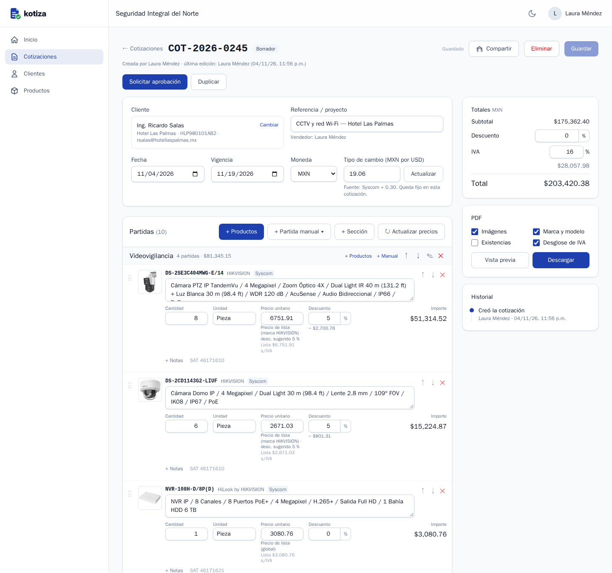
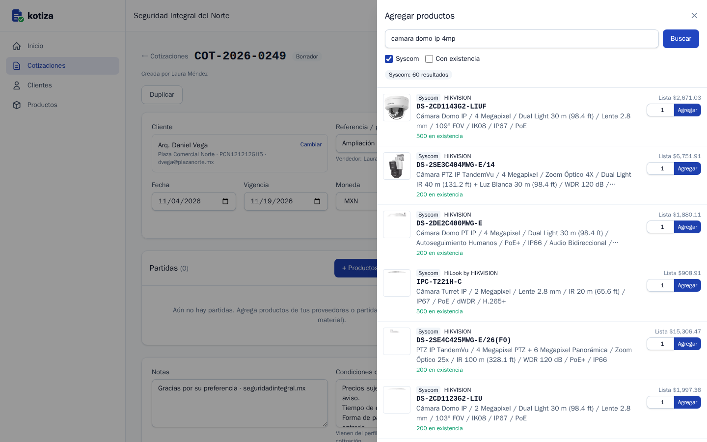
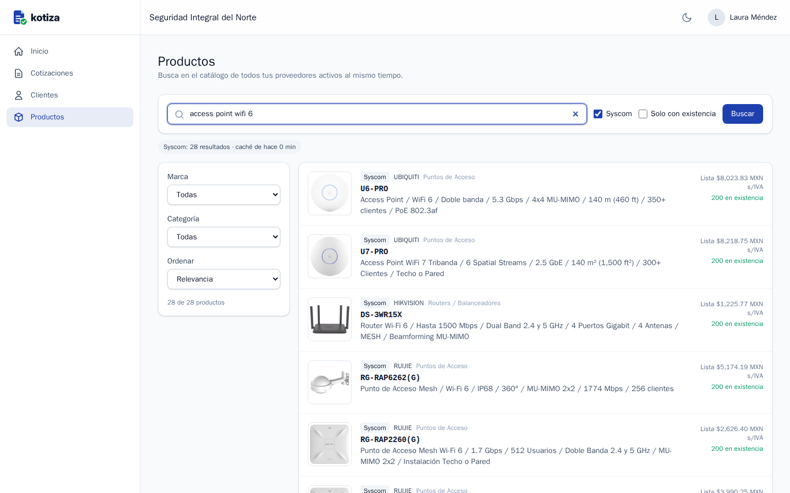
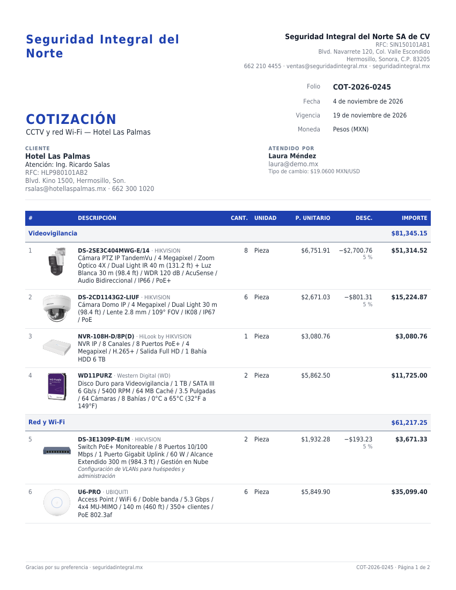
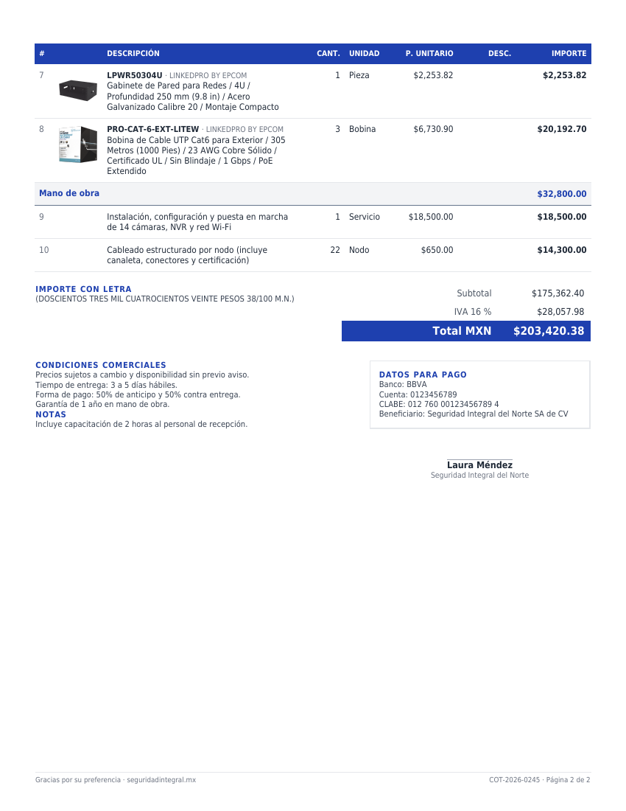
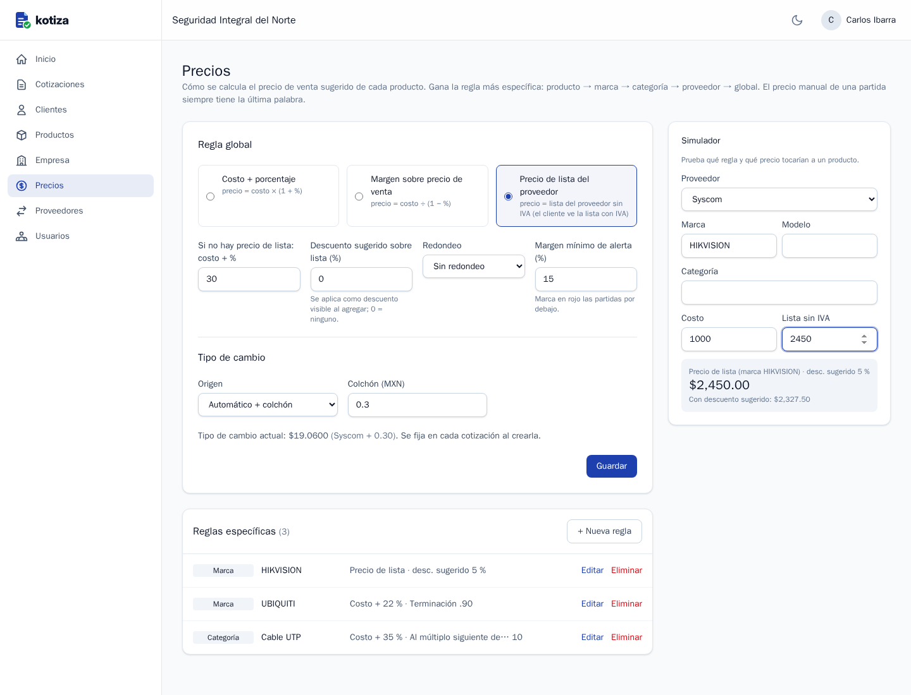
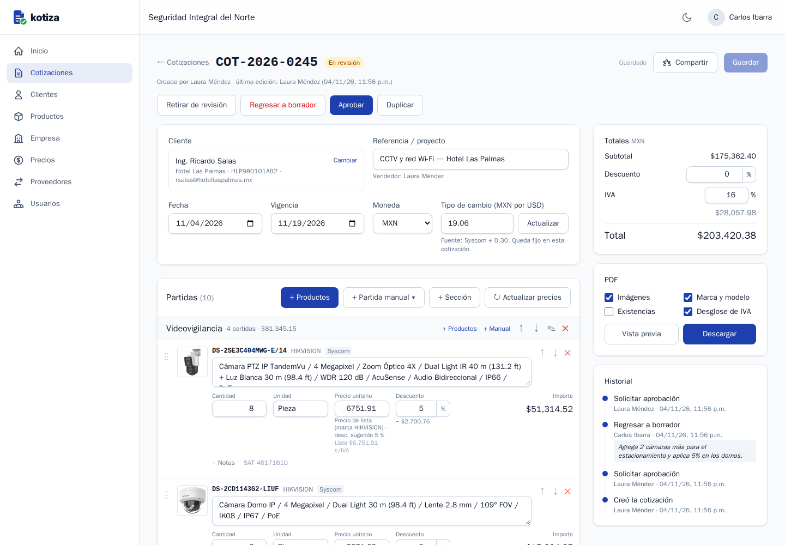
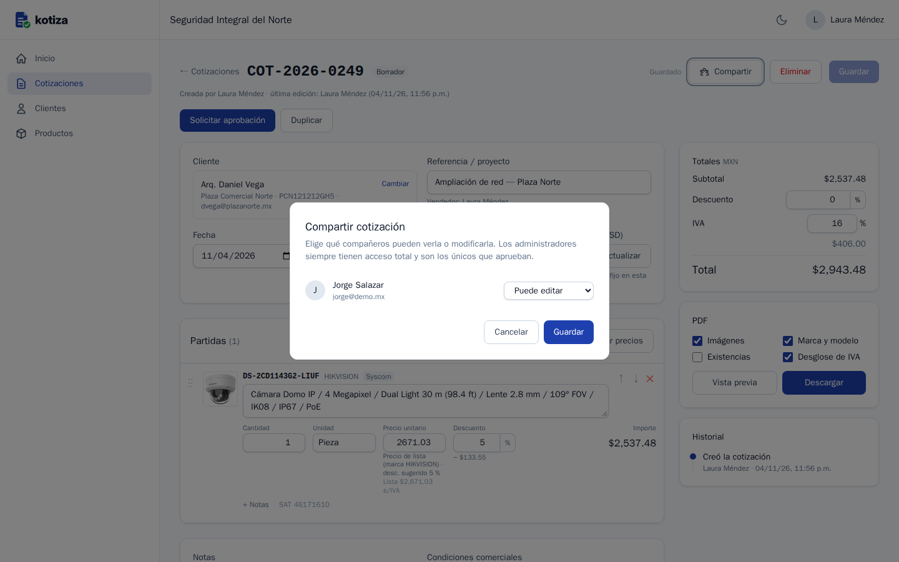
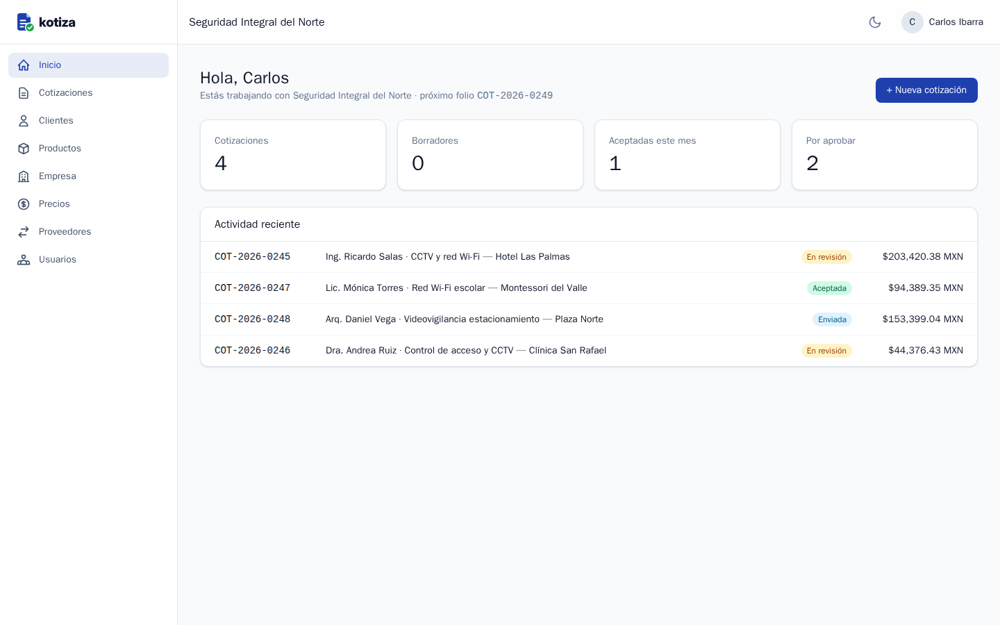
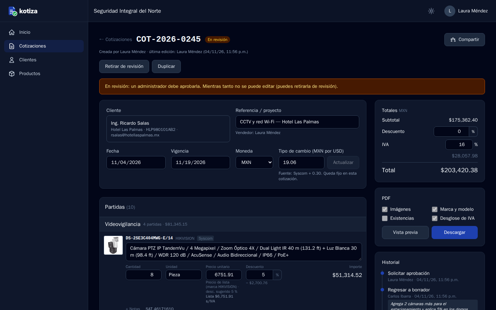

<p align="center">
  <picture>
    <source media="(prefers-color-scheme: dark)" srcset="public/assets/brand/kotiza-logo-dark.svg">
    
  </picture>
</p>

<h3 align="center">Cotizaciones profesionales en minutos, con precios y existencias reales de tus mayoristas.</h3>

<p align="center">
  Busca en el catálogo de tus distribuidores, arma la propuesta y entrega un PDF con tu marca.<br>
  Hecho para integradores de <b>videovigilancia, redes, control de acceso y telecomunicaciones</b> en México.
</p>

<p align="center">
  
</p>

---

## ¿Por qué Kotiza?

Cotizar un proyecto suele significar abrir el portal de cada mayorista, copiar modelos y precios a una hoja de cálculo, convertir dólares, calcular márgenes a mano y luego pelear con el formato del PDF. Kotiza junta todo en un solo lugar:

| | |
|---|---|
| **Precios siempre reales** | Costo, precio de lista y existencias por almacén directo de la API de tu mayorista, con tu nivel de distribuidor. |
| **Tu margen, sin calculadora** | Reglas por marca, categoría o producto. Usa el precio de lista sugerido o tu costo + porcentaje. |
| **PDF con tu marca** | Tu logo u hoja membretada, condiciones, datos bancarios, firma y la cantidad con letra. |
| **Control del equipo** | Aprobaciones del administrador, límites de descuento por vendedor y cotizaciones compartidas. |
| **Tus datos, en tu servidor** | Se instala en tu propio equipo (Docker / ZimaOS). Nadie más ve tus costos ni tus clientes. |

---

## Busca en todos tus mayoristas a la vez

Escribe un modelo o una descripción y Kotiza consulta a todos tus proveedores al mismo tiempo. Ves foto, marca, existencias por almacén y precio de lista. Cuando un mismo modelo aparece en varios mayoristas, marca el **más barato**.

<p align="center"></p>

<details>
<summary><b>Ver el catálogo de productos</b></summary>
<p align="center"></p>
</details>

## Cotiza como se trabaja en campo

- Partidas de producto y **partidas manuales** para mano de obra, instalación, cableado o material diverso.
- **Secciones** ("Videovigilancia", "Red", "Mano de obra") con subtotales, y orden arrastrando y soltando.
- Precio manual, **descuento por partida o global** (en % o en $) y totales que se actualizan mientras escribes.
- **Pesos o dólares**, con el tipo de cambio del proveedor (o el tuyo, o con colchón) fijo en cada cotización.
- **↻ Actualizar precios** con un clic: ves qué cambió en costo, precio y existencia antes de aplicarlo.
- **Versiones** (v2, v3…) con el mismo folio, y **duplicar** para reutilizar una propuesta.

## Un PDF que da gusto enviar

Tu hoja membretada como fondo (o tu logo y datos fiscales), las partidas por sección con imagen, totales, **importe con letra**, condiciones comerciales, datos para pago y la firma del vendedor. Sale con el nombre listo para enviar: `COT-2026-0245_Hotel-Las-Palmas.pdf`.

<p align="center">
  
  
</p>

La **vista previa en vivo** se actualiza mientras editas. Puedes elegir si se muestran imágenes, marcas, existencias y el desglose de IVA.

## Precios que se calculan solos

Define cómo vendes y Kotiza aplica la regla más específica a cada producto: **producto → marca → categoría → proveedor → global**.

- **Precio de lista del proveedor**: el precio sugerido del mercado, con un descuento sugerido opcional.
- **Costo + porcentaje** o **margen sobre venta**.
- Precio mínimo y redondeo (.00, .90 o al múltiplo que quieras).
- Un **simulador** para probar cualquier combinación antes de cotizar.
- Alerta en rojo cuando una partida queda por debajo de tu **margen mínimo**. Costos y utilidad solo los ve quien debe verlos.

<p align="center"></p>

## Trabajo en equipo, con control

- **Aprobación del administrador**: el vendedor envía a revisión y el administrador aprueba o regresa la cotización con un comentario. Hasta entonces el PDF lleva la marca de agua *BORRADOR*.
- **Límite de descuento por vendedor**: si lo rebasa, la cotización espera aprobación.
- **Historial** de cada movimiento: quién, cuándo y por qué.
- **Compartir** una cotización con un compañero para que la revise o la modifique.
- **Edición simultánea segura**: si dos personas guardan al mismo tiempo, nadie pierde sus cambios.
- **Vencimiento automático** al terminar la vigencia.

<p align="center"></p>

<p align="center"></p>

## Todo lo demás que esperas

- **Tablero** con cotizaciones, borradores, aceptadas del mes y pendientes de aprobar.
- **Multi-empresa**: varias razones sociales en una misma instalación, cada una con su marca, folios, usuarios y credenciales.
- **Folios** configurables (`COT-2026-0001`) que reinician cada año, o continúan tu consecutivo actual.
- **Catálogo de clientes** reutilizable.
- **Modo claro y oscuro**, interfaz 100 % en español y adaptable a celular.

<p align="center"></p>

<p align="center"></p>

---

## Mayoristas compatibles

| Mayorista | Estado |
|---|---|
| **Syscom** | ✅ Conectado: búsqueda inteligente, precios con tu nivel de distribuidor, existencias por almacén y tipo de cambio |
| **TVC** | 🔧 En integración: catálogo sincronizado automáticamente |
| ¿Otro? | Los conectores son modulares: [agrega tu mayorista](CONTRIBUTING.md#agregar-un-mayorista) y compártelo con la comunidad |

Tus credenciales de cada mayorista se guardan **cifradas** y nunca se vuelven a mostrar.

## Instalación

Kotiza se instala en tu propio servidor con Docker: en una PC, un NAS o un equipo ZimaOS.

```bash
git clone https://github.com/jofuentes/cotizador.git kotiza && cd kotiza
cp .env.example .env        # define la URL y genera la clave de cifrado
docker compose up -d --build
```

Abre la URL y un asistente te guía para crear tu cuenta y tu empresa. Los requisitos, la configuración y los respaldos están en la [documentación técnica](docs/TECNICO.md).

## Contribuir

Kotiza es software libre y gratuito. Puedes usarlo, modificarlo y tomarlo como punto de partida para tu propio proyecto. Lee la [guía para contribuir](CONTRIBUTING.md) si quieres enviar mejoras o conectores para otros mayoristas, y la [política de seguridad](SECURITY.md) para reportar vulnerabilidades.

## Licencia

Copyright © 2026 Jesus Oswaldo Espinosa Fuentes y colaboradores de Kotiza.

Este programa es software libre: puedes redistribuirlo y modificarlo bajo los términos de la [Licencia Pública General de GNU](LICENSE), versión 2 o (a tu elección) cualquier versión posterior (`GPL-2.0-or-later`). Se distribuye **sin ninguna garantía**. Si distribuyes una versión modificada, debes ofrecer también su código fuente bajo esta misma licencia.

Los PDF y demás documentos que generes con Kotiza son tuyos: la licencia cubre el programa, no tus cotizaciones.

Kotiza no está afiliado a Syscom, TVC ni a las marcas que aparecen en este repositorio; sus nombres pertenecen a sus respectivos dueños. El uso de cada API se rige por las condiciones de su mayorista, y cada usuario necesita sus propias credenciales.

---

<p align="center">
  <br>
  <sub><b>Kotiza</b> · antes llamado Cotizador · Hecho en México</sub>
</p>
