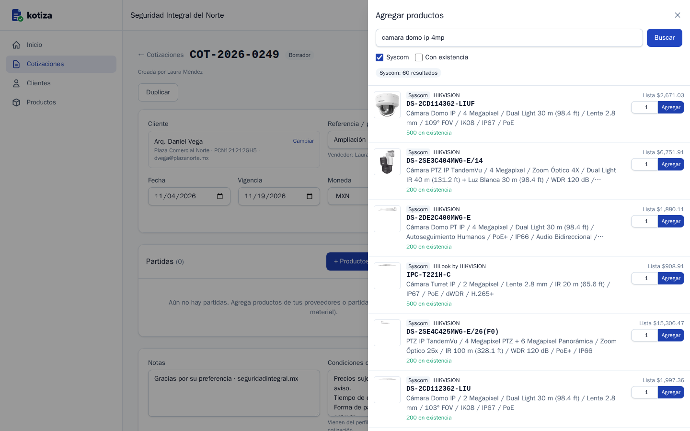
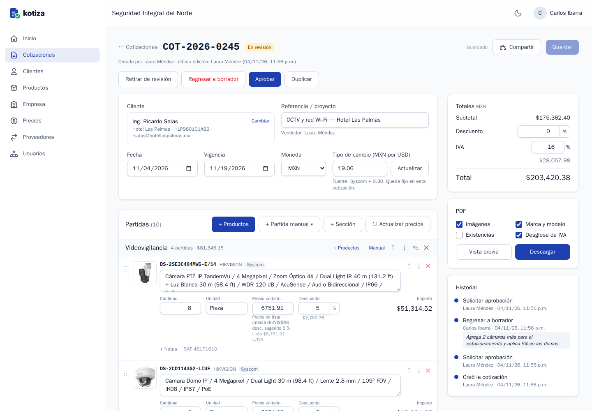
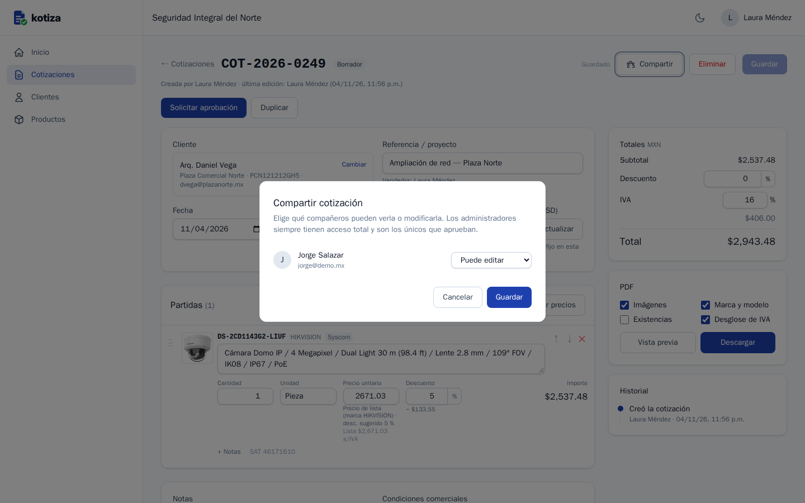
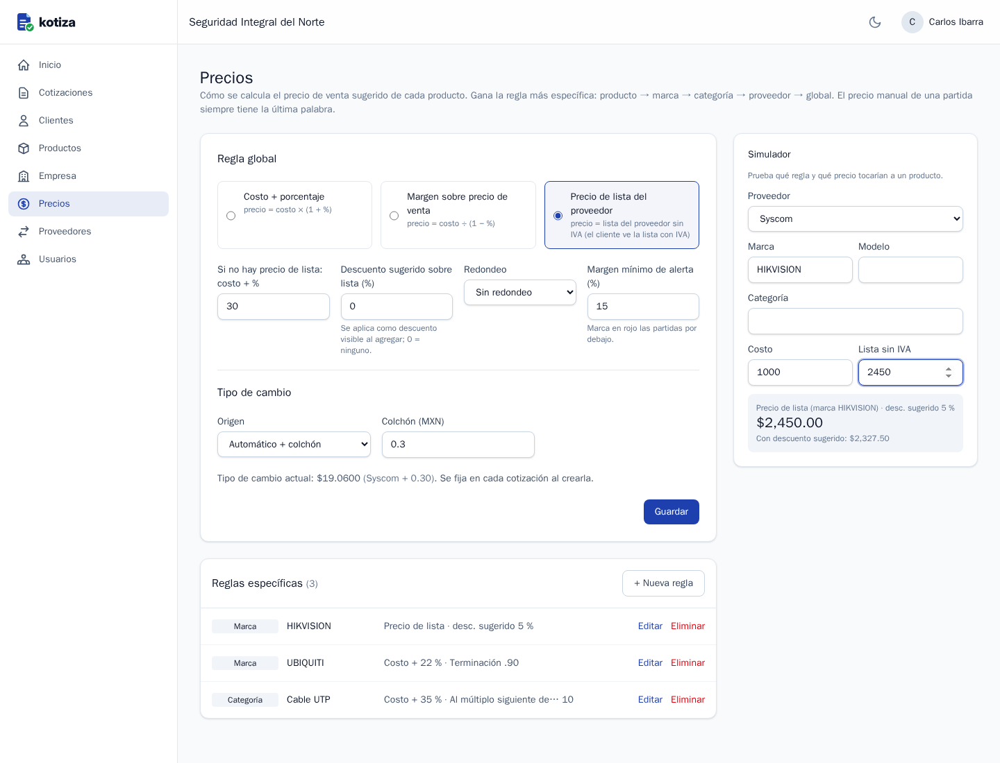

<p align="center"></p>

# Manual de Kotiza

Kotiza te ayuda a crear cotizaciones con los productos, precios y existencias de tus mayoristas, y a entregarlas en un PDF con la marca de tu empresa.

Este manual tiene dos partes:

- **[Parte 1: uso diario](#parte-1-uso-diario).** Para vendedores y administradores.
- **[Parte 2: administración](#parte-2-administración).** Solo para administradores.

Para instalar Kotiza en un servidor, consulta la [documentación técnica](TECNICO.md).

### ¿Qué puede hacer cada rol?

| Acción | Vendedor | Administrador |
|---|---|---|
| Crear y editar sus cotizaciones | ✅ | ✅ |
| Ver todas las cotizaciones de la empresa | Solo las propias y las compartidas | ✅ |
| Administrar clientes y buscar productos | ✅ | ✅ |
| Aprobar cotizaciones y descuentos | ❌ | ✅ |
| Configurar empresa, precios, proveedores y usuarios | ❌ | ✅ |

---

# Parte 1: uso diario

## Entrar a Kotiza

1. Abre la dirección que te dio tu administrador.
2. Escribe tu **Correo** y **Contraseña**, y elige **Entrar**.
3. Si trabajas con varias empresas, elige una. Después puedes cambiarla en **Empresa activa**, en el menú lateral.

Tras 5 intentos fallidos, el acceso se bloquea hasta por 15 minutos.

### Si olvidaste tu contraseña

1. En la pantalla de acceso, elige **¿Olvidaste tu contraseña?** y escribe tu correo.
2. Abre el enlace que recibirás. Revisa también la carpeta de spam. Vence a los 30 minutos y solo funciona una vez.
3. Crea tu contraseña nueva, de al menos 10 caracteres.

Si tu empresa no configuró el correo, esa opción no aparece y debes pedir ayuda a tu administrador. Al cambiar tu contraseña se cierran las demás sesiones abiertas.

## Tu perfil

Abre el menú con tu nombre, arriba a la derecha, y elige **Mi perfil**. Ahí puedes cambiar:

- **Nombre completo, correo y contraseña.** Para cambiar el correo o la contraseña debes escribir tu **Contraseña actual**. La nueva debe tener al menos 10 caracteres.
- **Nombre en cotizaciones.** Es como apareces como vendedor en el PDF.
- **Mi firma.** Usa un PNG con fondo transparente, de 2 MB como máximo.

El ícono de la luna o el sol, junto a tu nombre, cambia entre el modo claro y el oscuro.

## Clientes

Los clientes se comparten con todo el equipo de la empresa. Para agregar uno:

1. Ve a **Clientes** y elige **+ Nuevo cliente**.
2. Escribe el **Nombre del contacto**, que es el único dato obligatorio.
3. Completa los datos que tengas: empresa, RFC, correo, teléfono y dirección.
4. Elige **Crear cliente**.

Las **Notas internas** son para tu equipo. Un cliente que ya tiene cotizaciones no se puede eliminar.

## Buscar productos

En **Productos** puedes consultar el catálogo sin crear una cotización:

1. Escribe un modelo, una marca o una descripción, por ejemplo `DS-2CD2143G2-I` o `cámara domo 4MP`.
2. Elige **Buscar**.
3. Si lo necesitas, activa **Solo con existencia** o filtra por **Marca** y **Categoría**.
4. Abre un producto para ver su ficha con existencias, clave SAT y garantía.

Si un modelo aparece en varios mayoristas, Kotiza marca el **Más barato**. Si un mayorista no responde, puede mostrar el último dato guardado e indicar su antigüedad.

## Crear una cotización

### 1. Empieza la cotización

1. Elige **+ Nueva cotización**.
2. Busca al **Cliente**. Si no existe, créalo primero en **Clientes**, o déjalo vacío y elígelo después.
3. Escribe la **Referencia / proyecto**, por ejemplo `CCTV bodega norte`, y elige la **Moneda**.
4. Elige **Crear y agregar partidas**.

Kotiza asigna el folio y propone la fecha y la vigencia, que puedes ajustar. El tipo de cambio queda fijo en la cotización; usa **Actualizar**, junto a ese campo, si quieres tomar el actual.

### 2. Agrega las partidas

- **+ Productos** abre el buscador. Escribe qué buscas, indica la cantidad y elige **Agregar**.
- **+ Partida manual** sirve para lo que no viene del catálogo: partida libre, servicio, mano de obra, instalación o material diverso.
- **+ Sección** agrupa las partidas con su propio subtotal, por ejemplo "Videovigilancia" o "Mano de obra".

<p align="center"></p>

Para reordenar, arrastra una partida desde su asa (⋮⋮) o usa las flechas ↑ y ↓.

### 3. Ajusta precios y descuentos

El precio unitario se calcula con las reglas de tu empresa. En cada partida puedes:

- **Cambiar el precio.** Queda marcado como manual, y **Manual · restaurar** recupera el precio calculado.
- **Aplicar un descuento**, en porcentaje o en monto.
- **Agregar notas**, que sí se imprimen en el PDF.

En **Totales** también puedes aplicar un descuento global y ajustar el IVA.

Si tu descuento supera tu límite, verás el aviso **Excede tu límite**. La cotización necesitará la aprobación de un administrador.

El panel **Interno** muestra costo, utilidad y margen, y nunca aparece en el PDF. Tu empresa puede ocultarlo a los vendedores.

> **Tu trabajo se guarda solo.** Kotiza guarda los cambios cada 30 segundos. También puedes usar **Guardar** o `Ctrl+S`.

### 4. Actualiza precios antes de entregar

Si la cotización lleva tiempo abierta, elige **↻ Actualizar precios**. Kotiza te muestra qué cambió y el total actual y el nuevo. Los cambios se aplican solo si los confirmas, y los precios capturados a mano se respetan.

### 5. Revisa y descarga el PDF

1. En el panel **PDF**, elige qué mostrar: **Imágenes**, **Marca y modelo**, **Existencias** y **Desglose de IVA**.
2. Elige **Vista previa** para revisarlo.
3. Elige **Descargar**.

Si tu empresa exige aprobación, el PDF lleva la marca de agua **BORRADOR** hasta que un administrador la aprueba. Si la cotización vence, lleva la marca **VENCIDA**.

### 6. Entrégala al cliente

**Kotiza no envía las cotizaciones por correo.** Descarga el PDF, mándalo por tu medio habitual y luego elige **Marcar como enviada** para mantener el registro al día.

## Estados de una cotización

| Estado | Qué significa | Siguiente paso |
|---|---|---|
| **Borrador** | Se está preparando. | **Solicitar aprobación** o, si no se exige, **Marcar como enviada**. |
| **En revisión** | Espera a un administrador y el vendedor ya no puede editarla. | El administrador la aprueba o la regresa. El vendedor puede usar **Retirar de revisión**. |
| **Aprobada** | Ya se puede entregar. | **Marcar como enviada**. |
| **Enviada** | Ya la tiene el cliente. | **Aceptada por el cliente** o **Rechazada por el cliente**. |
| **Aceptada** | El cliente dijo que sí. | No requiere más pasos. |
| **Rechazada** | El cliente dijo que no; se pide el motivo. | Puedes crear una nueva versión. |
| **Vencida** | Pasó la vigencia de una cotización aprobada o enviada. | Puedes registrar la respuesta del cliente o crear una nueva versión. |

Si un administrador te regresa una cotización, su comentario aparece en ella y en el **Historial**. Corrige lo que pida y solicita la aprobación de nuevo.

<p align="center"></p>

## Cambiar o reutilizar una cotización

- **Nueva versión** crea v2, v3, etc., con el mismo folio. Úsala cuando la cotización ya no se pueda editar. Las versiones anteriores siguen disponibles.
- **Duplicar** crea una cotización con otro folio y las mismas partidas. Sirve para reutilizar una propuesta.
- **Eliminar** solo está disponible en borradores, para su creador o un administrador.

## Trabajar con tu equipo

Para que un compañero te ayude, elige **Compartir** y asígnale **Puede ver** o **Puede editar**. Solo el creador o un administrador pueden compartir una cotización. Los administradores tienen acceso a todas sin necesidad de compartirlas.

Si dos personas editan a la vez, Kotiza rechaza el segundo guardado y avisa quién guardó primero. Recarga la página para ver la versión actual y vuelve a capturar tus últimos cambios.

<p align="center"></p>

## Problemas frecuentes

| Problema | Qué hacer |
|---|---|
| No aparece **Marcar como enviada** | La cotización necesita aprobación, o tiene descuentos pendientes. Solicítala a un administrador. |
| No puedo editar la cotización | Ya salió de borrador. Si está **En revisión**, usa **Retirar de revisión**. Si ya fue aprobada, pide a un administrador que la reabra. En los demás casos, crea una **Nueva versión**. |
| "No hay proveedores activos" | Pide a un administrador que conecte un mayorista. Mientras tanto, puedes usar partidas manuales. |
| No veo una cotización de un compañero | Pídele que la comparta contigo. |
| No veo costos ni utilidad | Tu empresa los ocultó a los vendedores. |

---

# Parte 2: administración

## Primeros pasos

La primera vez que abres Kotiza, un asistente crea tu cuenta de administrador, tu empresa y tus folios. Si ya llevas un consecutivo, escribe en **Siguiente número** el que te toca.

Después, sigue este orden:

1. **[Empresa](#empresa):** tus datos y tu marca en el PDF.
2. **[Proveedores](#proveedores):** la conexión con tus mayoristas.
3. **[Precios](#precios):** cómo se calcula el precio de venta.
4. **[Usuarios](#usuarios):** las cuentas de tu equipo.
5. **[Correo](#correo-para-recuperar-contraseñas):** opcional, para que cada persona pueda recuperar su contraseña.

Antes de crear cotizaciones para clientes, haz una de prueba y revisa su PDF.

## Empresa

| Pestaña | Qué se configura |
|---|---|
| **Datos generales** | Nombre comercial, razón social, RFC, régimen fiscal, dirección y contacto. |
| **Identidad visual** | Logo, hoja membretada, colores y márgenes del PDF. |
| **Cotización** | Vigencia por defecto, datos bancarios, condiciones comerciales, notas al pie y firma de la empresa. |
| **Folios, impuestos y permisos** | Formato de folio, moneda, IVA y permisos. |

**Sobre el PDF:**

- **Logo:** PNG, JPG o SVG, de hasta 2 MB. Se usa en el PDF si no hay hoja membretada.
- **Hoja membretada:** PDF o imagen tamaño carta o A4, de hasta 10 MB. Ajusta los márgenes para que el contenido no se encime con el encabezado ni el pie.

**Permisos importantes:**

- **Ocultar costos y utilidad a los vendedores:** solo verán precios de venta.
- **Las cotizaciones requieren aprobación de un administrador:** ninguna podrá marcarse como enviada sin aprobación, y el PDF llevará la marca **BORRADOR** hasta entonces.

## Proveedores

Cada empresa usa sus propias credenciales de distribuidor. Se guardan cifradas y no se vuelven a mostrar. Para conectar un mayorista:

1. Ve a **Proveedores** y elige **Conectar**.
2. Captura las credenciales que te da el mayorista.
3. Pon el **Estado** en **Activo** y define la **Prioridad**; el 1 se muestra primero.
4. Guarda y elige **Probar conexión**.

| Mayorista | Dónde obtener las credenciales | A tener en cuenta |
|---|---|---|
| **Syscom** | Client ID y Client Secret en [developers.syscom.mx/clients](https://developers.syscom.mx/clients) | Para que el costo coincida con el precio principal de syscom.mx, usa «Tu precio de distribuidor», con descuento financiero e IVA. |
| **TVC** | Token en tvc.mx → Mi Perfil → API Clientes; TVC debe aprobarlo | Conector en integración. El catálogo se descarga cada 12 horas o con **Sincronizar ahora**. |

Si algo falla, **Ver log** muestra cada llamada al mayorista con su resultado y su tiempo. En **Caché de productos** defines cuánto tiempo se reutilizan los datos antes de volver a consultarlos.

Cumple también las condiciones de uso de la API de cada mayorista, porque tu cuenta es responsabilidad tuya.

## Precios

La **regla global** se aplica a todos los productos, salvo que una **regla específica** la reemplace. Gana la más específica:

> precio manual de la partida → producto → marca → categoría → proveedor → global

| Método | Cálculo | Con costo de $1,000 y 25 % |
|---|---|---|
| **Costo + porcentaje** | costo × (1 + %) | $1,250 |
| **Margen sobre precio de venta** | costo ÷ (1 − %) | $1,333.33 |
| **Precio de lista del proveedor** | Precio de lista sin IVA, con descuento sugerido opcional | Depende del precio de lista |

En esta pantalla también configuras:

- **Redondeo:** al peso siguiente, terminación .90 o al múltiplo que elijas.
- **Margen mínimo de alerta:** marca en rojo las partidas que queden por debajo.
- **Tipo de cambio:** automático del proveedor, automático con un colchón en pesos o manual. Se fija en cada cotización al crearla.
- **Simulador:** escribe marca, costo y precio de lista para ver qué regla se aplicaría, sin afectar ninguna cotización.

<p align="center"></p>

## Usuarios

En **Usuarios**, elige **+ Nuevo usuario**, captura sus datos y su **Rol**. Comparte la contraseña inicial por un medio seguro y pídele que la cambie en **Mi perfil**.

- **Descuento máximo sin aprobación:** se aplica a vendedores. Si lo dejas vacío, no tendrán límite. Se suma al descuento sugerido por tus reglas de precios.
- **Desactivar a alguien:** no se eliminan usuarios. Pon su **Estado** en **Inactivo** y ya no podrá entrar a esa empresa.
- **Usuarios en varias empresas:** si escribes un correo que ya tiene cuenta, solo se agrega a esta empresa. Su nombre, correo y contraseña solo los puede cambiar esa persona.

No puedes cambiar tu propio rol ni desactivarte, y una empresa siempre debe conservar un administrador activo. Si solo hay uno, **Usuarios** muestra un aviso: conviene crear un segundo.

## Correo para recuperar contraseñas

Esta sección solo aparece para los administradores de la primera empresa de la instalación, porque la cuenta se usa en todas las empresas. Es opcional y solo sirve para recuperar contraseñas.

1. Usa una cuenta de Gmail, de preferencia exclusiva para esto, y activa su [verificación en dos pasos](https://myaccount.google.com/security).
2. Crea una [contraseña de aplicación](https://myaccount.google.com/apppasswords). No uses tu contraseña normal.
3. En **Correo**, captura la cuenta, el **Nombre del remitente** y la contraseña de aplicación, y elige **Comprobar y guardar**.
4. Elige **Enviarme un correo de prueba** y confirma que llega.

## Aprobar cotizaciones

El contador **Por aprobar** de la pantalla de inicio muestra las pendientes. Al abrir una, puedes:

- **Aprobar**, lo que también aprueba sus descuentos.
- **Regresar a borrador**, con un comentario sobre qué debe corregirse.
- **Aprobar descuentos**, si la empresa no exige aprobar cada cotización y solo hay descuentos sobre el límite.
- **Reabrir para editar**, si una cotización ya aprobada necesita cambios.

## Varias empresas

Para agregar otra razón social, abre el menú con tu nombre y elige **Nueva empresa**. Cada una tiene su propia marca, folios, usuarios, clientes, precios y credenciales.

## Respaldos y mantenimiento

**Haz respaldos con regularidad.** Debes guardar tres cosas: la base de datos, los archivos de `storage` y el archivo `.env`. Sin la `APP_KEY` de `.env`, no podrás descifrar las credenciales de los mayoristas. Los comandos para respaldar, restaurar y actualizar están en la [documentación técnica](TECNICO.md#respaldos-y-actualizaciones).

**Restablecer una contraseña:**

- Si el correo está configurado, la persona puede hacerlo sola con **¿Olvidaste tu contraseña?**.
- Desde **Usuarios**, edita a la persona y escribe una contraseña nueva. Esto no está disponible si pertenece a varias empresas.
- Desde el servidor, ejecuta el siguiente comando. También desbloquea sus intentos de acceso, y es la vía si ningún administrador puede entrar:

```bash
docker compose exec app php bin/reset-password.php correo@empresa.com
```

## Problemas frecuentes

| Problema | Qué revisar |
|---|---|
| No llega el correo de recuperación | Pide revisar spam. Elige **Enviarme un correo de prueba** en **Correo**. Hay un límite de 3 solicitudes por hora por persona. Los errores aparecen en `docker compose logs app`. |
| El enlace de recuperación no abre | Revisa que `APP_URL` en `.env` sea la dirección correcta de Kotiza. |
| Falla **Probar conexión** | Revisa las credenciales y abre **Ver log** para ver el error. |
| Los precios parecen desactualizados | Baja la vigencia en **Caché de productos** o marca **Vaciar caché al guardar**. |
| El costo no coincide con el sitio del mayorista | Revisa los **Ajustes del conector** del proveedor. |
| Los productos de TVC no aparecen | Revisa la sincronización en su pantalla de proveedor y usa **Sincronizar ahora**. |
| El contenido se encima con el membrete | Ajusta los márgenes del PDF en **Empresa → Identidad visual**. |
